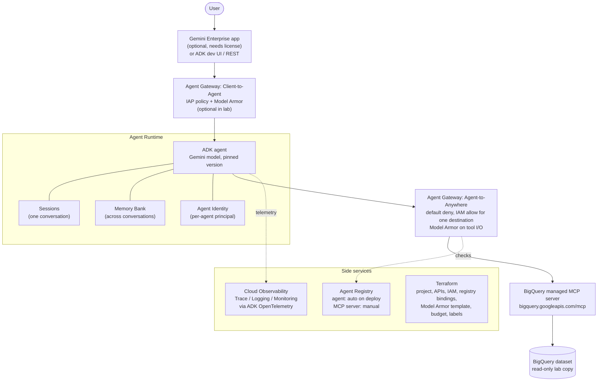
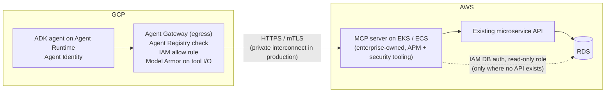

# Agent Archetype on Google Cloud: Reference Architecture (Lab)

Status: draft, 2026-11-12
Purpose: build one governed agent on Google's managed agent stack, and map enterprise AI platform terms to Google's products.
Out of scope: Kubernetes. The lab uses Google's managed runtime on purpose; section 4 covers what that means for an enterprise that standardizes on Kubernetes.

---

## 1. Terms

See [terms.md](terms.md) for definitions and for how platform terms (harness, registry, control plane, intelligence layer, archetype) map to Google products.

---

## 2. Lab architecture

---

## 3. Component choices

| Concern | Lab choice | Why | Production note |
|---|---|---|---|
| Agent framework | ADK (Python) | Google's code-first framework, and it deploys straight to Agent Runtime | Model-agnostic, so it doesn't lock the enterprise into Gemini at the code level |
| Model | Gemini Flash-class model, version pinned | Cheap and fast enough for tool calling | Pin versions in the archetype; model upgrades go through evals |
| Model choice | Model name read from config; optional Claude via Model Garden using ADK's Claude adapter. Per-request routing through a router agent or `before_model_callback`. | Switching models is a config change plus an eval run, not a rewrite. Claude called through Model Garden runs under Google Cloud's service terms, IAM, audit logs, and GCP billing (Model Garden is the catalog; those controls are what keep data in Google Cloud). | Standardize the platform, controls, and eval gate, with an approved model list in Model Garden. Avoid calling the Anthropic API directly (separate key and bill, data leaves Google). Some ADK built-in tools only work with Gemini. |
| Model switch: code vs. Terraform | Agent code picks the model: `LlmAgent(model=os.environ["AGENT_MODEL"])`, with ADK's Claude adapter registered once at startup (or the LiteLLM wrapper). The value is set in the ADK CLI env file at deploy time. Terraform grants access: `aiplatform.googleapis.com`, `roles/aiplatform.user` for the agent principal (second pass, after deploy). Manual: enabling Claude in Model Garden (accepting Anthropic's terms) and the regional quota request. | Switching models = change one env var, redeploy, re-run the golden set. Terraform doesn't change. | If the agent deploy moves into Terraform (`google_vertex_ai_reasoning_engine`), the model name becomes a Terraform variable passed as an env var; verify the resource supports env vars. Adapter import path, model ID format, and whether enabling Claude can be automated are on the section 8 verify list. |
| Runtime | Agent Runtime | Gets Agent Identity, Agent Gateway, and auto-registration today | Conflicts with a Kubernetes standard (section 4) |
| Identity | Agent Identity per agent; no shared service account, no keys | Can't be impersonated, no long-lived keys, scoped to one agent | Redeploying creates a new principal and old bindings stop applying, so IAM grants must live in the deploy pipeline |
| Tool access | One managed MCP server; `roles/mcp.toolUser`, `roles/bigquery.jobUser`, `roles/bigquery.dataViewer` on one dataset | Least privilege, read-only | MCP standard = registered server + IAM grant to the agent principal + gateway allow rule |
| Tool allowlist | Agent Registry + Agent Gateway egress, default deny | The gateway checks the registry and IAM before routing | Stops MCP sprawl: an MCP server that isn't registered can't be called |
| Content safety | Model Armor template attached to the gateway | Scans prompts and tool responses for injection and data leaks | One shared template set per data classification |
| Front door | Gemini Enterprise app if a license is available; otherwise ADK dev UI | Shows how the employee app connects to the platform | Needs an OAuth authorization resource when the agent acts on the user's behalf |
| Observability | Cloud Trace / Logging / Monitoring via ADK OpenTelemetry (ADK 1.17+) | On by default for Agent Runtime | Traces include prompts and responses, so classify them as sensitive. Export to a third-party APM is unverified (section 8). |
| FinOps | Labels on every resource (`agent`, `owner`, `cost-center`, `env`); budget alert | Basis for a tagging standard | Attributing token costs per agent is the hard part; measure what Monitoring exposes |
| Human-in-the-loop | Confirmation step on any write tool (ADK tool confirmation) | Fits a risk-tiered review intake: auto-approve low risk, a person approves high risk | Map risk tiers to which tools need confirmation |
| Evaluation | `adk eval` / Agent Platform Evals with a small golden set | Regression gate for model and prompt changes | Evals become a CI/CD gate ("continuous compliance") |
| Infrastructure as code | Terraform for everything except the agent deploy (ADK CLI) until the provider resource is confirmed | Repeatable, reviewable | Platform in Terraform, agent in the app pipeline |

---

## 4. Where Google's defaults conflict with a Kubernetes standard

1. **Agent Runtime is serverless.** If the reason for requiring Kubernetes is that security tooling and the APM have to reach the workload, that reason applies to Agent Runtime as much as to Cloud Run.
2. **Google's governance ships on managed runtimes first.** Agent Gateway is available for Agent Runtime and Gemini Enterprise; GKE, Cloud Run, and cross-cloud are "coming soon" (early preview sign-up). Agent Identity supports Agent Runtime, Gemini Enterprise, and Cloud Run; GKE isn't listed. Choosing GKE today means building identity and egress policy yourself, or waiting.
3. **Single pane of glass.** Google sends agent telemetry to Cloud Observability. If the 24/7 ops team works in another tool (for example Dynatrace), getting from one to the other (OTLP export or a vendor integration) has to be settled before handoff.
4. **Cross-cloud identity.** Agent Identity is a Google trust domain. SaaS agents and AWS services sit outside it. The cross-cloud gateway isn't available yet.
5. **Governance boundary.** Agent Registry lives in a governance project (single project, folder, or org scope). Each gateway governs up to 5,000 registered resources. Deciding where the registry lives is itself an EA decision.

**Open questions**

1. Is Agent Runtime treated as serverless and therefore not allowed, or as a managed runtime governed by Google's own controls (Gateway, Identity, Model Armor)? The answer decides whether the archetype is "ADK on Agent Runtime" or "ADK on GKE plus self-built identity and egress."
2. Is the requirement Kubernetes, or that security and ops can see and control the workload? If Agent Gateway, Agent Identity, and Model Armor cover security, and the agent's traces reach the ops team's APM, could agents be the one category allowed on the managed runtime? If not, what would have to be true?

The Kubernetes rule usually exists so that security tooling, a single ops pane of glass, runbooks, and multi-cloud portability all hold. Question 2 keeps those reasons and asks whether the rule itself is the requirement, which moves architecture from a gate toward enablement. The lab answers part of it: whether Agent Runtime traces can be exported to a third-party backend (section 8).

---

## 5. Cross-cloud tool access (AWS)

When transactional systems run on AWS, the pattern is: the MCP server runs in AWS next to the data and is registered in Google. Google's registry and gateway control who can call it; AWS controls what it can touch.

| Piece | Role |
|---|---|
| Agent Registry | The AWS MCP endpoint is registered by hand; registered MCP servers and endpoints don't have to be in Google |
| Agent Gateway (Agent-to-Anywhere) | Blocks the call by default; an IAM policy allows this agent to reach this endpoint; Model Armor scans the request and the response |
| AWS side | MCP server on EKS so the APM and security tooling cover it (meets a Kubernetes standard); reaches data with IAM DB auth and a read-only role |
| Network | Lab: public HTTPS with strong authentication. Production: a private cross-cloud link (AWS Interconnect multicloud / Cross-Cloud Interconnect; status to verify) |

**Identity across clouds is the hard part:**

| Kind | Question | Options |
|---|---|---|
| Agent to AWS | How does AWS know this call came from this agent? | The MCP server, or AWS API Gateway in front of it, validates a Google-issued token for the agent; or AWS STS exchanges it for a short-lived role; or Agent Identity's 24-hour X.509 certificate with IAM Roles Anywhere. Which of these Agent Identity supports is unverified. |
| User to data | Whose data may the agent see? | On-behalf-of OAuth through the enterprise identity provider; Gemini Enterprise's authorization resource handles the consent flow |

**Patterns, in order of preference**

1. **MCP in front of an existing AWS microservice API.** Keeps the API's business rules and authorization in place. An agent writing SQL against RDS goes around both.
2. **MCP Toolbox for Databases on EKS, in front of RDS.** Google's open-source database MCP server (Postgres, MySQL) exposes fixed, parameterized queries from a YAML file, not open-ended SQL. Use only where no API exists.
3. **Agent to agent (A2A).** If an AWS team owns an agent (for example on Bedrock AgentCore), the Google agent calls it over A2A. Each cloud keeps its own agent and controls.
4. **Analytics go to BigQuery, not RDS.** If data and analytics already land in GCP, keep the transactional database out of agent traffic for analytical questions.

**Later:** Google's cross-cloud gateway (Envoy-based, "coming soon") would apply the same gateway policies on the AWS side. Until then, Google enforces outbound policy and AWS enforces access to the data.

---

## 6. Decision record

**Context.** The goal is to learn Google's agent governance stack, not Kubernetes. Google's governance features (Agent Identity, Agent Gateway, auto-registration) are available today mainly on Agent Runtime.

**Decision.** The lab runs on Agent Runtime with Agent Identity, egress through Agent Gateway (default deny), Model Armor, and one Google-managed MCP server. No GKE.

**Consequences.**
- Hands-on experience with every Google piece behind the platform's harness, registry, and control plane.
- Not a production-ready pattern for a Kubernetes-standard enterprise; it doesn't satisfy an APM and security-tooling requirement on its own.
- Gives a concrete, first-hand basis for the section 4 conversation.

---

## 7. Cost (approximate)

Rates are mostly from third-party pricing write-ups (October–November 2026) and GKE rates are from memory. Check them against Google's price list before quoting.

**Lab, light bursty use (a few hundred test conversations a month)**

| Item | Rate | Lab estimate / month |
|---|---|---|
| Agent Runtime compute | $0.085/vCPU-hr, $0.009/GiB-hr; free 50 vCPU-hr + 100 GiB-hr per billing account; idle between turns reportedly unbilled | ~$0 (default 4 vCPU / 4 GiB; 10 active hours = 40 vCPU-hr) |
| Sessions / Memory Bank | $0.30/GiB-month storage; reads/writes fractions of a cent | ~$0 |
| Gemini Flash tokens | Per token | $1–5 |
| Agent Gateway | $0.085 per 15,000 calls (billed since 2026-07-13) | Pennies |
| Model Armor | Free up to 2M tokens/month | $0 |
| BigQuery + MCP server | 1 TB queries and 10 GB storage free | $0 |
| Cloud Trace / Logging | Free tiers (2.5M spans, 50 GiB logs) | $0 |
| Agent Registry | Not found | Assume $0; verify |
| Gemini Enterprise seat (optional) | $21 (Business, annual) to $35 (Standard, monthly) per user | $21–35, unless a trial is available |
| **Total** | | **~$1–10 without a seat; ~$30–45 with one** |

**Risk:** if Agent Runtime keeps a warm instance running, 4 vCPU × 730 hr × $0.085 + 4 GiB × 730 hr × $0.009 ≈ **$275/month**. Set minimum instances to 0 if configurable, or delete the deployment between sessions. Terraform sets budget alerts at $25 and $50.

**Agent Runtime vs. GKE for the same workload**

| | Agent Runtime | GKE Autopilot |
|---|---|---|
| Cluster fee | None | ~$73/mo, covered by the free credit for one cluster per billing account |
| Compute | Billed while handling requests | ~$20/mo for one 0.5 vCPU / 1 GiB pod running 24/7 |
| Ingress load balancer | None | ~$18/mo |
| Session / memory store | Built in | Bring your own (Firestore free tier) |
| Agent Gateway | Included | Not yet available on GKE |
| **Lab total** | **~$0–10/mo** | **~$40–60/mo** |

- **Unit rate:** Agent Runtime's per-vCPU rate (~$0.085/hr) is about double Autopilot's (~$0.045/hr). Under steady load, GKE costs about half as much for the same compute.
- **An enterprise that already runs clusters:** one more agent on GKE only costs its pod's resources. At that scale, GKE is likely cheaper on infrastructure.
- **What the numbers leave out:** on GKE, the enterprise builds and runs session storage, per-agent identity, registry entries, and egress policy themselves. That engineering cost usually outweighs the difference in compute.
- **FinOps point for the archetype:** token spend, not compute, will dominate at production volume. The tagging standard needs to attribute token usage per agent, not just label the infrastructure.

---

## 8. Build plan and open questions

**Day 1.** Terraform baseline (project, APIs, budget, labels). Write the ADK agent and run it locally against the BigQuery MCP server.
**Day 2.** Deploy to Agent Runtime. Grant IAM to the agent principal. Register the MCP server. Turn on the egress gateway with default deny and Model Armor. Check traces.
**Day 3.** Golden-set evals and the human-in-the-loop write tool. Register in Gemini Enterprise if a license is available. Optional: switch the agent to Claude via Model Garden, re-run the golden set, and record how tool calling and cost differ. Update this page with what turned out differently.

**Verify during the build**
- Preview vs. GA status of: the BigQuery MCP server, Agent Gateway, Agent Registry.
- Cloud API Registry (the December 2025 MCP announcement) vs. Agent Registry: is one replacing the other, or do they work together?
- Whether a personal project can get a Gemini Enterprise license or trial.
- Terraform coverage for Agent Gateway and Agent Runtime deployments.
- OTLP export from Agent Runtime to a third-party backend (the Dynatrace question).
- The current ADK API for tool confirmation.
- Cross-cloud identity: whether Agent Identity can present a token or certificate that AWS (API Gateway JWT authorizer, STS, or IAM Roles Anywhere) accepts.
- Status of the AWS and Google cross-cloud interconnect offering.
- Claude on Model Garden: which regions it's available in near the agent's region, the quota, and the current ADK Claude adapter import path and model ID format, and whether enabling Claude in Model Garden can be scripted or must be done in the console.

---

## Sources

- [Gemini Enterprise Agent Platform name changes](https://docs.cloud.google.com/gemini-enterprise-agent-platform/vertex-ai-name-changes)
- [Agent Platform agents overview](https://docs.cloud.google.com/gemini-enterprise-agent-platform/agents)
- [Agent Gateway overview](https://docs.cloud.google.com/gemini-enterprise-agent-platform/govern/gateways/agent-gateway-overview)
- [Agent Identity overview](https://docs.cloud.google.com/iam/docs/agent-identity-overview)
- [Agent Registry overview](https://docs.cloud.google.com/agent-registry/overview)
- [Announcing official MCP support for Google services](https://cloud.google.com/blog/products/ai-machine-learning/announcing-official-mcp-support-for-google-services)
- [Register ADK agents hosted on Agent Runtime in Gemini Enterprise](https://docs.cloud.google.com/gemini/enterprise/docs/register-and-manage-an-adk-agent)
- [Instrument ADK applications with OpenTelemetry](https://docs.cloud.google.com/stackdriver/docs/instrumentation/ai-agent-adk)
- [Agent Gateway ingress to Agent Runtime with Model Armor (codelab)](https://codelabs.developers.google.com/agw-cuj-arun-ingress-modar)
- Pricing (third-party): [Agent Runtime or Cloud Run? (William Denniss)](https://wdenniss.com/agents/runtime-choice/), [Agent Runtime pricing comparison](https://www.beri.net/article/agentcore-vs-agent-engine-vs-foundry-agent-service-pricing-runtime-memory-tools-2026), [Gemini Enterprise pricing 2026](https://coworker.ai/blog/gemini-enterprise-pricing)
- [Model Armor pricing (Google)](https://cloud.google.com/security/products/model-armor)
